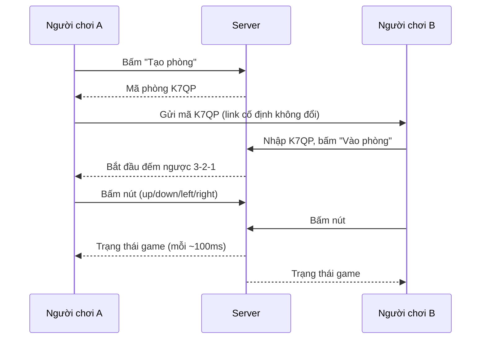

# Kế hoạch (v2): Game 2 người online, điều khiển 4 nút

## 1. Mục tiêu

- Chỉ **1 link cố định duy nhất** (vd `https://ten-game.onrender.com`), gửi 1 lần dùng mãi.
- Vào link có 2 lựa chọn: **[Tạo phòng]** → nhận **mã phòng 4 ký tự** (vd `K7QP`); hoặc **[Vào phòng]** → nhập mã. Gửi mã cho bạn là chơi được.
- Chạy tốt trên **điện thoại** (ưu tiên) và máy tính, không cần cài đặt/đăng ký.
- Điều khiển **4 nút ↑ ↓ ← →**: nút cảm ứng lớn trên màn hình (điện thoại), phím mũi tên/WASD (máy tính).
- Giao diện responsive, chặn zoom/cuộn khi bấm nút.


## 2. Game đề xuất: "Tranh Xu" (Coin Grab)

- Bản đồ lưới 15x15, 2 nhân vật (đỏ / xanh) di chuyển từng ô bằng 4 nút.
- Xu xuất hiện ngẫu nhiên; ai ăn được thì +1 điểm.
- Có vài tường đơn giản làm chướng ngại.
- Hết 60 giây, ai nhiều điểm hơn thắng. Có nút "Chơi lại".
- Phương án khác cùng kiểu 4 nút: Rắn săn mồi 2 người, Tron (xe để lại vệt, đâm là thua). Có thể đổi nếu bạn thích.


## 3. Luồng hoạt động



**Server là nguồn sự thật** (chống gian lận, 2 máy luôn khớp nhau): client chỉ gửi hướng, server tính vị trí, ăn xu, điểm, thời gian rồi phát lại cho cả hai.

## 4. Công nghệ

| Phần       | Lựa chọn                                                                                   |
| ---        | ---                                                                                        |
| Giao diện  | HTML + Canvas + JavaScript thuần                                                           |
| Server     | Node.js + Express + Socket.IO                                                              |
| Link cố định | **Render** (miễn phí, 1 URL dùng mãi, deploy từ GitHub) |

## 5. Cấu trúc thư mục

```
Project_Play_Together/
├─ server.js        # phòng, vòng lặp game, luật
├─ package.json
└─ public/
   ├─ index.html    # Tạo phòng / nhập mã vào phòng / game
   ├─ game.js       # canvas, nhận trạng thái, gửi phím
   └─ style.css
```

## 6. Thiết kế chi tiết

**Trạng thái phòng:**

```js
{ id, players:[{id, x, y, score, color}], coin:{x,y}, walls:[...], timeLeft, status:'waiting|countdown|playing|ended' }
```

**Sự kiện:**
| Event | Hướng | Ý nghĩa |
|---|---|---|
| `create-room` | C→S | tạo phòng, server trả mã 4 ký tự (vd `K7QP`) |
| `join-room` | C→S | gửi mã phòng; lỗi nếu sai mã / phòng đầy |
| `dir` | C→S | gửi hướng 4 nút |
| `state` | S→C | trạng thái mới (~10 lần/giây) |
| `rematch` | C→S | chơi lại |
| `opponent-left` | S→C | đối thủ thoát |

**Quy tắc:** mỗi tick di chuyển 1 ô theo hướng cuối cùng; không đi xuyên tường/biên; phòng tối đa 2 người, người thứ 3 báo "phòng đầy".

## 7. Các bước

1. Khởi tạo Node, cài `express`, `socket.io`.
2. Server: tạo mã phòng 4 ký tự (không trùng), vào phòng bằng mã, vòng lặp game + luật.
3. Client: màn hình chính (Tạo phòng / Vào phòng), canvas, nút cảm ứng 4 hướng.
4. Màn hình chờ (hiện mã phòng + nút copy), đếm ngược, kết quả, chơi lại.
5. Test 2 tab trình duyệt, rồi test bằng điện thoại cùng mạng Wi-Fi.
6. Deploy lên Render để có 1 link cố định.

> Lưu ý: gói miễn phí của Render "ngủ" sau ~15 phút không dùng, lần mở đầu có thể chờ ~30-60 giây. Phòng game lưu trong bộ nhớ nên khởi động lại server thì phòng mất (không ảnh hưởng vì game ngắn).

## 8. Ngoài phạm vi (để sau)

Đăng nhập, xếp hạng, chat, nhiều người, chơi với máy.

## 9. Cần bạn chốt

- Game: **Tranh Xu** (đề xuất) / Rắn 2 người / Tron?
- Link cố định: Render miễn phí (đề xuất) — bạn có tài khoản GitHub chưa (cần để deploy)?
